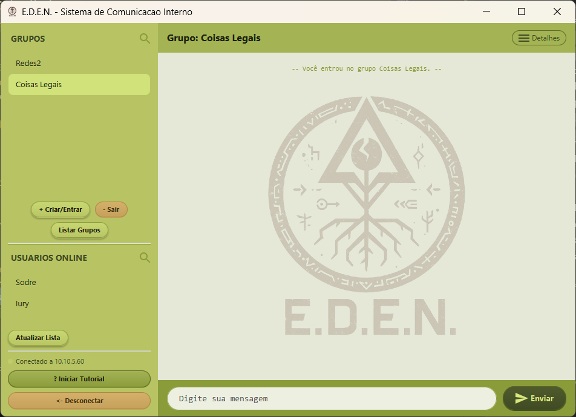
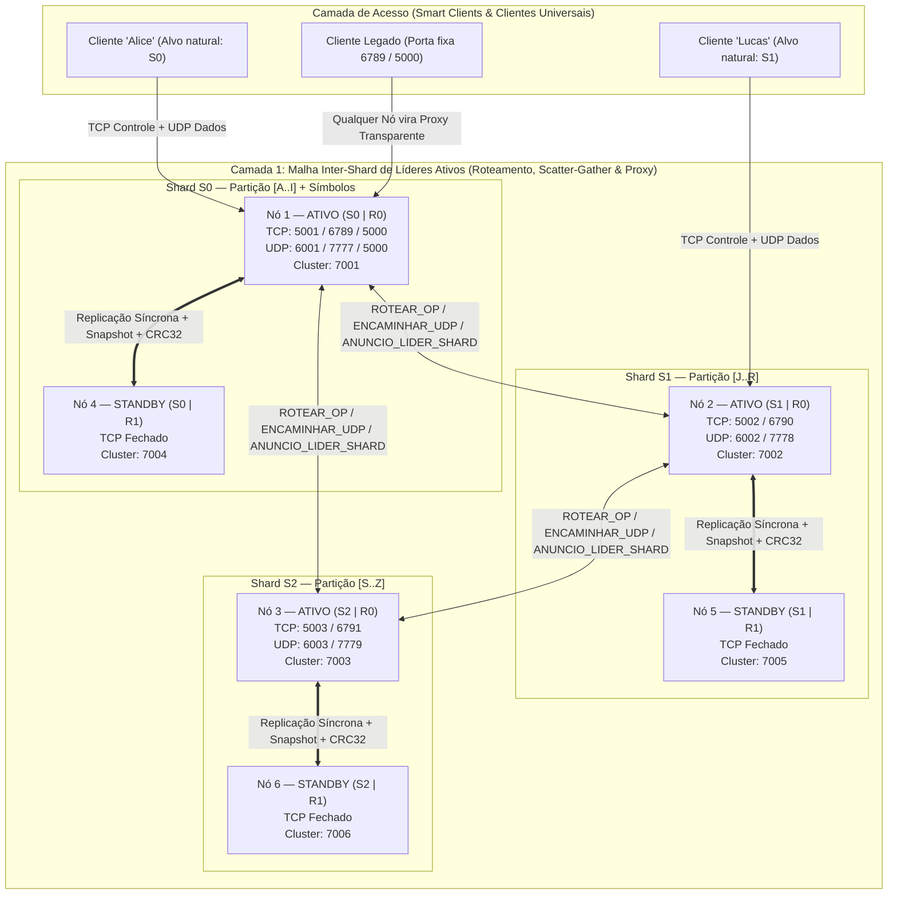
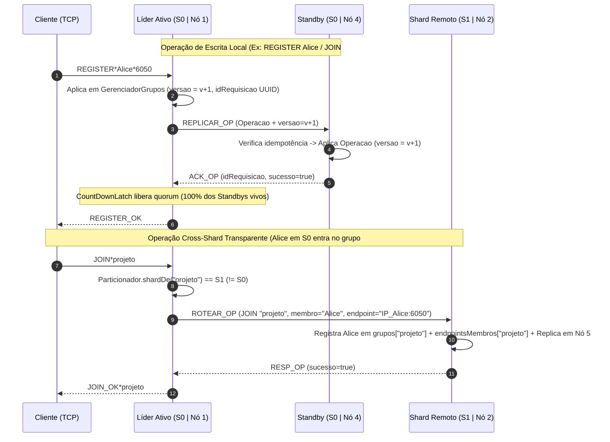
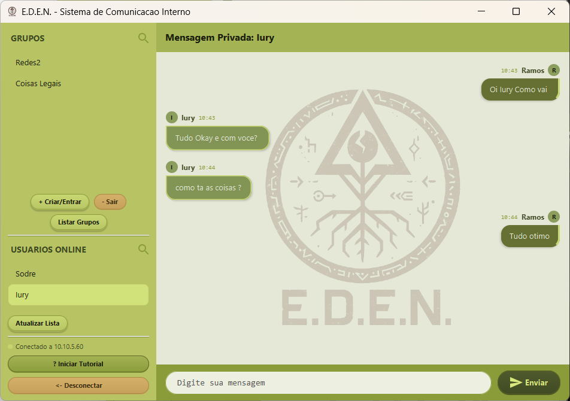
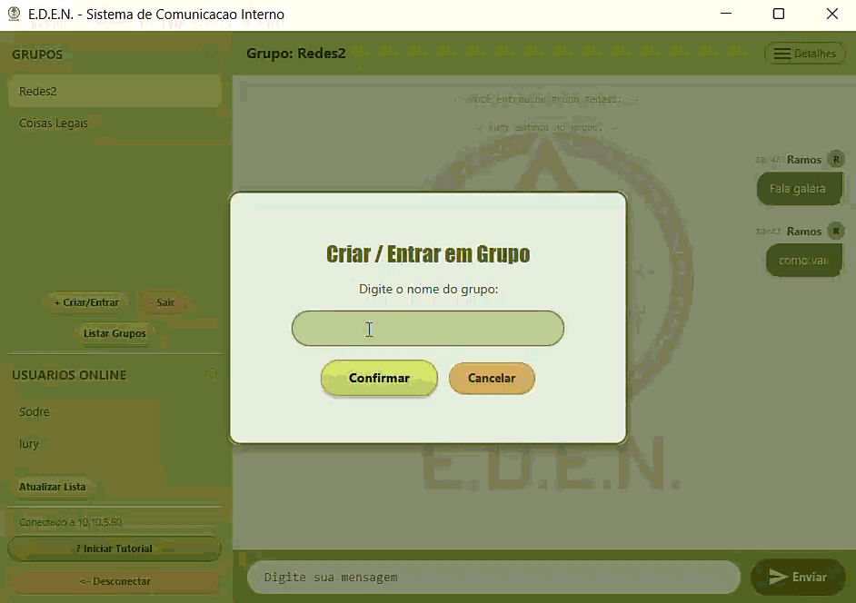

# E.D.E.N. v3.0 — Plataforma Distribuída de Mensageria com Sharding Horizontal e Replicação Síncrona




---

## Sumário Executivo

O **E.D.E.N.** (*Environment for Distributed Event-driven Networking*) é um sistema distribuído de comunicação instantânea em tempo real projetado em **Java SE (Sockets POSIX TCP/UDP puros e JavaFX)**, sem dependência de *brokers* externos, bancos de dados gerenciados ou *frameworks* de RPC de terceiros.

Em sua arquitetura de **3ª geração (Trabalho 03)**, o sistema evolui de um cluster replicado monolítico para uma **arquitetura distribuída híbrida em duas camadas**, combinando **Particionamento Horizontal Determinístico (*Data Sharding*)** com **Replicação Primário-Backup Síncrona Intra-Shard** e **Roteamento Proxy Transparente (*Any-Node Gateway*)**:

1. **Escalabilidade Horizontal de Estado (3 Shards Independentes):** O espaço global de chaves (usuários, salas de grupo, mensagens privadas e recibos de entrega/leitura) é particionado deterministicamente em três partições ortogonais — **`S0 [A..I]`**, **`S1 [J..R]`** e **`S2 [S..Z]`** — cada qual liderada por seu próprio coordenador ativo.
2. **Alta Disponibilidade Intra-Shard ($1$ Líder Ativo + $K$ Standbys por Partição):** Dentro de cada shard, múltiplos processos operam sob consenso com replicação síncrona em barreira (`CountDownLatch`), transferência atômica de *Deep Snapshot*, verificação contínua de integridade por `CRC32` e eleição automática sem preempção.
3. **Transparência de Localização e Failover Universal:** Qualquer nó ativo opera como *Gateway* universal. Clientes inteligentes (*Smart Clients*) ou clientes legados universais podem conectar-se a **qualquer** partição e interagir com usuários e grupos de todo o cluster via *Proxy Inter-Shard* (`ROTEAR_OP`), *Scatter-Gather* paralelo resiliente e encaminhamento UDP em salto único (*Single-Hop Forwarding*).
4. **Topologia 100% Autônoma (*Zero-Config*):** Processos iniciados na mesma máquina (`localhost`) ou em múltiplas máquinas físicas na LAN descobrem automaticamente os nós vivos via *Beacons* UDP, alocam IDs globais sem colisão, priorizam a cobertura das três partições antes de alocar réplicas *Standby* e reconfiguram clientes em tempo real durante quedas bruscas (`kill -9`).

### Identificação Acadêmica e Autoria

| Campo | Detalhamento |
| :--- | :--- |
| **Autor** | **Iury Ramos Sodré** |
| **Matrícula** | `202310440` |
| **Instituição** | Universidade Estadual do Sudoeste da Bahia (**UESB**) |
| **Disciplina** | Sistemas Distribuídos — 8º Semestre (Ciência da Computação) |
| **Escopo (Trabalho 03)** | Particionamento Horizontal em 3 Shards, Roteamento Transparente Inter-Shard e Replicação Intra-Shard com Failover sem Perda de Estado |

---

## Visão Geral da Arquitetura Distribuída

O diagrama a seguir ilustra a interação entre clientes, a malha inter-shard de líderes ativos e os anéis intra-shard de replicação síncrona na topologia canônica de **6 processos** ($3 \text{ Shards} \times 2 \text{ Réplicas}$):



---

## Engenharia de Sistemas: Decisões Técnicas e Mecanismos Internos

### 1. Particionamento Horizontal Determinístico (`Particionador`)

Tanto o servidor (`Servidor/cluster/Particionador.java`) quanto o cliente (`Cliente/utils/Particionador.java`) compartilham uma função pura $f(k) \in \{0, 1, 2\}$ livre de estado externo. Antes do cálculo, a chave passa por **normalização Unicode canônica (`Normalizer.Form.NFD`)**, remoção de marcas diacríticas (`\p{InCombiningDiacriticalMarks}+`), remoção de prefixos de escopo (`@`, `#`) e conversão para caixa alta:

| Shard | Intervalo Léxico | Exemplos de Chaves (Usuários / Grupos) | Regra de Contorno |
| :---: | :---: | :--- | :--- |
| **`S0`** | **`[A .. I]`** | `Alice`, `Álvaro` $\rightarrow$ `ALVARO`, ` Bruno`, `#avisos`, `123teste` | Absorve dígitos, símbolos, espaços e chaves vazias/nulas |
| **`S1`** | **`[J .. R]`** | `Joao`, `Lucas`, `Maria`, `#projeto`, `#redes` | Caracteres iniciais entre `J` e `R` |
| **`S2`** | **`[S .. Z]`** | `Sofia`, `Tiago`, `Zeca`, `#sistemas`, `#uesb` | Caracteres iniciais entre `S` e `Z` |

#### Matriz de Propriedade de Estado (*Data Ownership*)

Para evitar transações distribuídas bloqueantes (*Two-Phase Commit*) no caminho crítico de mensagens, cada entidade possui um único shard autoritativo bem definido no `GerenciadorGrupos`:

| Entidade / Operação | Shard Autoritativo (Dono) | Estratégia de Consistência e Roteamento Cross-Shard |
| :--- | :--- | :--- |
| **Sessão e Endpoint do Usuário** (`REGISTER`) | `shardDe(nomeUsuario)` | Mantido em `usuarios` do shard dono. Se o cliente estiver conectado via TCP em outro shard, o gateway repassa `ROTEAR_OP` com o `IP:portaUDP` real do cliente. |
| **Metadados e Membros de Grupo** (`JOIN`, `LEAVE`) | `shardDe(nomeGrupo)` | Mantido em `grupos` do shard do grupo, acompanhado do cache **`endpointsMembros`** (`nomeGrupo -> {membro -> IP:portaUDP}`), permitindo *fan-out* UDP imediato sem consultar outros shards a cada mensagem. |
| **Mensagens de Grupo** (`SEND*grupo*...`) | `shardDe(nomeGrupo)` | O shard do grupo valida associação, persiste o `RegistroMensagem` para recibos agregados e dispara datagramas UDP diretamente aos endpoints locais e cross-shard registrados em `endpointsMembros`. |
| **Mensagens Privadas** (`SEND*@dest*...`) | `shardDe(destinatario)` | Roteada ao shard do destinatário, que verifica entrega, persiste `RegistroMensagem` e emite Auto-ACK `CONFIRM` (`ENTREGUE`) direto ao endpoint UDP do remetente. |
| **Recibos de Entrega/Leitura** (`CONFIRM`) | `shardDe(escopo)` (`grupo` ou `destinatario`) | Em grupos, o shard da sala agrega confirmações até atingir $N - 1$ membros antes de notificar o autor; em conversas privadas, notifica imediatamente o remetente. |
| **Lista de Bloqueios** (`BLOCK` / `UNBLOCK`) | Primário em `shardDe(bloqueador)` + **Réplica Global** | Persistido de forma síncrona no shard do bloqueador e propagado assincronamente aos demais líderes, garantindo filtragem de privacidade em tempo constante **`O(1)` local** durante *fan-outs* de grupos. |
| **Catálogo Global** (`LIST`, `USERS`) | Todos os 3 Shards | Executado por *Scatter-Gather* assíncrono paralelo (`CompletableFuture`) com *merge* sem duplicatas e tolerância a partições inativas. |

---

### 2. Topologia Autônoma *Zero-Config* e Álgebra de Portas (`ConfigCluster` & `PortasShard`)

Todo nó iniciado sem parâmetros descobre sua identidade global $\text{ID} \in [1, 99]$ sondando simultaneamente a rede local via broadcast UDP e as portas de controle na máquina local. A identidade determina algebricamente todas as portas e papéis do processo:

$$\text{idShard} = (\text{ID} - 1) \bmod 3, \qquad \text{idReplica} = \left\lfloor \frac{\text{ID} - 1}{3} \right\rfloor$$

$$\text{Porta}_{\text{TCP}} = 5000 + \text{ID}, \qquad \text{Porta}_{\text{UDP}} = 6000 + \text{ID}, \qquad \text{Porta}_{\text{Cluster}} = 7000 + \text{ID}$$

#### Algoritmo de Alocação Inteligente em Duas Prioridades
1. **Prioridade 1 — Cobertura Horizontal Imediata (`S0` $\rightarrow$ `S1` $\rightarrow$ `S2`):** Se qualquer uma das três partições ainda não possuir nenhum processo ativo na rede, o novo nó assume obrigatoriamente o menor ID da Réplica 0 da partição faltante (`ID 1` para `S0`, `ID 2` para `S1`, `ID 3` para `S2`), reservando atomicamente o `ServerSocket` da porta `7000 + ID` antes de liberar o *lock* de inicialização.
2. **Prioridade 2 — Balanceamento Vertical de *Standbys*:** Quando os três shards já estão cobertos, novos processos são alocados automaticamente como `STANDBY` para o shard com menor número atual de réplicas (`ID 4` $\rightarrow$ Standby `S0`, `ID 5` $\rightarrow$ Standby `S1`, `ID 6` $\rightarrow$ Standby `S2`, `ID 7..9` $\rightarrow$ 2º Standby de cada shard, e assim sucessivamente).

#### Solução para Cegueira de Broadcast UDP POSIX no `localhost`
Em kernels Linux, múltiplos processos escutando com `SO_REUSEADDR` na mesma porta UDP unicast/broadcast em `localhost` sofrem sombreamento de entrega (*unicast/broadcast socket shadowing*), onde apenas um descritor recebe o datagrama. O `BeaconClusterLAN` elimina esse fenômeno combinando:
- **Porta Dedicada por Processo (`9870 + ID` para `ID <= 10`):** Cada nó faz *bind* garantido em sua própria porta determinística de réplica além do farol base do shard (`9876 + idShard * 10`).
- **Varredura Isolada Tolerante a Falhas:** A sondagem dispara pacotes para `255.255.255.255`, sub-redes locais `/24` e `127.0.0.1` varrendo `9871..9880` e `9876, 9886, 9896`, com cada `socket.send()` encapsulado em bloco `try/catch` independente para que falhas de rota em interfaces desconectadas jamais abortem a descoberta em `loopback`.

#### Mapa Completo da Topologia Canônica (6 Processos)

| Processo | Shard | Réplica | Papel Inicial | TCP Nativo | UDP Nativo | TCP/UDP Interop. | TCP/UDP Legado | Canal Cluster | Beacon UDP |
| :---: | :---: | :---: | :---: | :---: | :---: | :---: | :---: | :---: | :---: |
| **Nó 1** | `S0 [A..I]` | `0` | **`ATIVO`** | `5001` | `6001` | `6789` / `7777` | `5000` / `5000` | `7001` | `9876` + `9871` |
| **Nó 2** | `S1 [J..R]` | `0` | **`ATIVO`** | `5002` | `6002` | `6790` / `7778` | — | `7002` | `9886` + `9872` |
| **Nó 3** | `S2 [S..Z]` | `0` | **`ATIVO`** | `5003` | `6003` | `6791` / `7779` | — | `7003` | `9896` + `9873` |
| **Nó 4** | `S0 [A..I]` | `1` | `STANDBY` | *(fechado)* `5004`* | *(fechado)* `6004`* | *(assume no failover)* | *(assume `5000`)* | `7004` | `9874` |
| **Nó 5** | `S1 [J..R]` | `1` | `STANDBY` | *(fechado)* `5005`* | *(fechado)* `6005`* | *(assume no failover)* | — | `7005` | `9875` |
| **Nó 6** | `S2 [S..Z]` | `1` | `STANDBY` | *(fechado)* `5006`* | *(fechado)* `6006`* | *(assume no failover)* | — | `7006` | `9876` |

*\*Em modo `STANDBY`, as portas de atendimento ao cliente permanecem estritamente fechadas. Ao ser promovido a `ATIVO`, o Standby abre suas portas nativas (`5000 + ID` / `6000 + ID`) e também tenta vincular proativamente as portas pioneiras/interoperáveis liberadas pelo líder caído (`5001`/`6001`, `6789..6791`/`7777..7779`, `5000`), maximizando a compatibilidade com clientes legados.*

---

### 3. Consenso Intra-Shard, Replicação Síncrona e Anti-Entropia (`NoCluster` & `Replicador`)



1. **Barreira de Quorum Síncrono (`Replicador`):** Toda mutação no `GerenciadorGrupos` gera uma `Operacao` determinística identificada por `idRequisicao` (`UUID`). O líder instancia um `CountDownLatch(standbysVivos.size())`, transmite `REPLICAR_OP` pela malha TCP persistente (`CanalCluster`) e aguarda os `ACK_OP` (timeout de `2500 ms` para absorver pausas de GC sem falsos-negativos) antes de confirmar a operação ao cliente.
2. **Clonagem Integral por *Deep Snapshot*:** Quando uma réplica inicia ou retorna de uma queda, ela transita para `SINCRONIZANDO` e solicita `PEDIDO_SYNC` ao líder. O líder serializa atomicamente (`synchronized`) um `Snapshot` contendo **todas** as estruturas internas de estado:
   - `versao` monotônica;
   - `usuarios` (registro da partição);
   - `endpointsMembros` (mapa cross-shard de `IP:portaUDP` de todos os integrantes de cada sala);
   - `grupos` (salas e conjuntos de membros);
   - `bloqueios` (grafo de privacidade);
   - `mensagens` (`RegistroMensagem` com conjuntos de destinatários pendentes/confirmados para os recibos de entrega e visualização);
   - `requisicoesProcessadas` (cache LRU limitado a `10.000` entradas para garantir **idempotência exata** em retransmissões durante comutações de líder).
3. **Anti-Entropia Contínua por `CRC32`:** Todo `HEARTBEAT` emitido pelo líder a cada `1000 ms` carrega `(versao, hashEstadoCRC32)`. Caso um `STANDBY` detecte divergência de versão persistente ou discrepância de `CRC32` na mesma versão, ele solicita ressincronização automática em background.
4. **Eleição Determinística Não-Preemptiva:** Quedas bruscas disparam `EOFException` imediata no `CanalCluster` (ou timeout de `3000 ms` de heartbeat). Os candidatos escalonam sua proposta por `(meuId - 1) * 80 ms` e desempatam estritamente por:
   $$\text{1º Maior } \text{versão de dados} \quad \succ \quad \text{2º Maior } \text{época} \quad \succ \quad \text{3º Menor } \text{ID de Nó}$$
   Nós que retornam após falha respeitam o coordenador vigente (`COORDENADOR` com `epoca >= local`), sincronizando como `STANDBY` **sem preempção**.

---

### 4. Failover Universal Cross-Shard, Detecção de `CLOSE_WAIT` e Auto-Cura

Um dos desafios clássicos em sistemas particionados com comunicação híbrida TCP+UDP ocorre quando o líder do **Shard `S0`** cai: clientes nativos de **`S1`** (ex.: `Lucas`) que não têm conexão TCP com `S0`, mas participam de grupos hospedados em `S0` (ex.: `#avisos`), continuariam enviando datagramas UDP para a porta morta `6001` se apenas os clientes locais de `S0` fossem avisados. O E.D.E.N. resolve todas essas arestas de falha:

- **Notificação Universal `SERVER_CHANGED` (`NotificadorClientes` + `NoCluster.assumirComoAtivo`):** Ao assumir a liderança, o novo coordenador calcula a **união completa de endpoints** armazenados em `usuarios` $\cup$ `endpointsMembros` $\cup$ `mensagens` (cobrindo clientes locais, membros externos de salas locais e remetentes/destinatários recentes) e dispara três rajadas UDP espaçadas (`0 ms`, `250 ms`, `750 ms`) contendo `SERVER_CHANGED*<novoHost>*<novaPortaTCP>*<novaPortaUDP>`, seguidas de anúncio inter-shard `ANUNCIO_LIDER_SHARD` para atualizar imediatamente a `TabelaLideres` dos demais shards.
- **Monitoramento Ativo de `EOF` contra Falsos-Positivos `CLOSE_WAIT` (`ClienteTCP`):** Em POSIX/JVM, `Socket.isConnected()` permanece retornando `true` mesmo após o servidor encerrar o processo (`FIN`/`RST` recebido em estado `CLOSE_WAIT`). O `ClienteTCP` executa sondagem ativa de leitura e detecção imediata de fim de fluxo (`readLine() == null` / `IOException`), acionando `executarFailover()` instantaneamente no `GerenciadorConexao` sem depender de `PING` periódico na camada de aplicação.
- **Evicção Distribuída de *Ghost Clients* (`USUARIO_CAIU`):** Quando o socket TCP de um cliente cai sem `EXIT` explícito e não reconecta dentro da janela de tolerância de failover (`5,5 s`), o nó detector remove a sessão local, propaga broadcast UDP intra/inter-shard `USUARIO_CAIU` (com deduplicação por `UUID`) e varre os shards via `REMOVER_USUARIO`, expurgando usuários fantasmas de todas as salas do cluster.
- **Detecção de Amnésia Total de Shard e Reconstrução Automática de Sessão:** Caso **todas** as réplicas de um shard sofram queda simultânea e reiniciem do zero (`versao = 0`), a `TabelaLideres` detecta a regressão de estado do líder e emite `INVALIDAR_SESSAO_CLIENTE`. Os clientes afetados reconstroem automaticamente sua sessão completa (`REGISTER` + re-entrada transparente em todos os grupos ativos `JOIN` + reaplicação da lista de `BLOCK`) sem intervenção do usuário e sem perder o histórico visual na interface JavaFX.

---

## Interface Gráfica (JavaFX) e Experiência do Usuário

<table>
  <tr>
    <td align="center" width="50%">
      <br/>
      <sub><b>Mensagens Privadas Cross-Shard</b> com indicadores visuais de entrega (<code>✓</code>) e leitura (<code>✓✓</code>) sincronizados entre partições.</sub>
    </td>
    <td align="center" width="50%">
      <br/>
      <sub><b>Salas de Grupo Distribuídas</b> com descoberta automática na LAN, catálogo global unificado (<i>Scatter-Gather</i>) e tutorial integrado.</sub>
    </td>
  </tr>
</table>

---

## Especificação dos Protocolos de Comunicação

### 1. Protocolo Cliente $\leftrightarrow$ Servidor (APDUs de Aplicação)

Separador padrão de campos: `*` (`Protocolo.SEPARADOR`).

| Canal | APDU / Comando | Formato da Mensagem | Semântica e Roteamento no Cluster |
| :---: | :--- | :--- | :--- |
| **TCP** | `REGISTER` | `REGISTER*<user>*<portaUDP>` | Registra sessão e endpoint no `shardDe(user)` (direto ou via proxy `ROTEAR_OP`). |
| **TCP** | `JOIN` / `LEAVE` | `JOIN*<grupo>` / `LEAVE*<grupo>` | Adiciona ou remove membro e seu `IP:portaUDP` em `endpointsMembros` no `shardDe(grupo)`. |
| **TCP** | `LIST` | `LIST` | *Scatter-Gather* paralelo nos 3 shards retornando `GROUPS*g1,g2,...` sem duplicatas. |
| **TCP** | `USERS` | `USERS*<grupo>` ou `USERS` | Lista membros do grupo no `shardDe(grupo)` ou todos os usuários online nos 3 shards. |
| **TCP** | `BLOCK` / `UNBLOCK` | `BLOCK*<alvo>` / `UNBLOCK*<alvo>` | Atualiza grafo de bloqueio no shard do autor com replicação global para filtragem `O(1)`. |
| **TCP** | `EXIT` | `EXIT` | Encerra sessão limpa e remove o usuário de todos os shards e grupos. |
| **UDP** | `SEND` (Grupo) | `SEND*<remetente>*<grupo>*<conteudo>*<idMsg>` | Roteado ao `shardDe(grupo)` (direto ou `ENCAMINHAR_UDP` em 1 salto) para *fan-out* UDP. |
| **UDP** | `SEND` (Privado) | `SEND*<remetente>*@<dest>*<conteudo>*<idMsg>` | Entregue via `shardDe(dest)` com emissão automática de recibo `ENTREGUE` ao autor. |
| **UDP** | `CONFIRM` | `CONFIRM*<leitor>*<escopo>*<idMsg>*<TIPO>` | Atualiza máquina de recibos (`ENTREGUE` / `VISUALIZADO`) e notifica autor (`✓` / `✓✓`). |
| **UDP** | `SERVER_CHANGED` | `SERVER_CHANGED*<host>*<tcp>*<udp>` | Emitido pelo novo líder promovido para atualizar imediatamente a rota TCP/UDP dos clientes. |
| **UDP** | `DISCOVER` | `DISCOVER_SHARDS_EDEN` / `DISCOVER_SERVER` | Descoberta multi-dialeto nas portas `8888` e `5001` retornando mapa de shards ou gateway. |

### 2. Protocolo Interno do Cluster (`MensagemCluster` & `BeaconClusterLAN`)

| Escopo | Tipo de Mensagem | Transporte | Função Técnica |
| :---: | :--- | :---: | :--- |
| **Intra-Shard** | `HEARTBEAT` | TCP Mesh (`7000+ID`) | Pulso periódico (`1s`) contendo época, papel, versão monotônica e hash `CRC32` do estado. |
| **Intra-Shard** | `ELEICAO` / `OK_ELEICAO` / `COORDENADOR` | TCP Mesh (`7000+ID`) | Subprotocolo de eleição determinística, supressão de candidatos inferiores e anúncio de posse. |
| **Intra-Shard** | `REPLICAR_OP` / `ACK_OP` | TCP Mesh (`7000+ID`) | Transmissão síncrona de mutação de estado e confirmação para liberação do `CountDownLatch`. |
| **Intra-Shard** | `PEDIDO_SYNC` / `SNAPSHOT` | TCP Mesh (`7000+ID`) | Transferência atômica integral de todos os mapas do `GerenciadorGrupos` + cache de idempotência. |
| **Intra-Shard** | `RENUNCIA` | TCP Mesh + Beacon UDP | Notificação graciosa de desligamento (`sair` / `SIGTERM`), disparando eleição em `0 ms`. |
| **Inter-Shard** | `ROTEAR_OP` / `RESP_OP` | TCP Inter-Shard | RPC idempotente entre gateways e líderes remotos com suporte a redirecionamento de líder. |
| **Inter-Shard** | `ENCAMINHAR_UDP` | TCP Inter-Shard | Repasse *single-hop* de payload UDP preservando `IP:portaUDP` original do cliente emissor. |
| **Inter-Shard** | `ANUNCIO_LIDER_SHARD` / `CONSULTA_LIDER_SHARD` | TCP + Beacon UDP | Convergência rápida da `TabelaLideres` após promoções de failover ou entrada de novos shards. |
| **Global** | `INVALIDAR_SESSAO_CLIENTE` / `USUARIO_CAIU` | TCP + Beacon UDP | Auto-cura em caso de amnésia total de partição e limpeza global de *ghost clients*. |

---

## Guia de Compilação, Execução e Operação

### Pré-requisitos
- **Java JDK 8+** com suporte a **JavaFX** (ex.: *Azul Zulu OpenJDK 8 FX*, *BellSoft Liberica Full JDK* ou *Oracle JDK 8*).
- Ambiente Linux, macOS ou Windows (scripts nativos `.sh` e `.bat` incluídos na raiz).

### 1. Compilação Limpa

```bash
./compilar.sh
```
*(Para remover todos os artefatos `.class`, diretórios `bin/` e logs temporários de execução anterior, utilize `./limpar.sh`).*

### 2. Inicialização Automática da Topologia Completa (6 Processos: 3 Shards × 2 Réplicas)

#### No Linux / macOS:
```bash
# Abre automaticamente 6 terminais (ou roda em background se não houver servidor gráfico)
./iniciar_cluster.sh

# Alternativa: Forçar execução em background gravando logs individuais em logs_cluster/
./iniciar_cluster.sh --bg

# Modo Rede Física (LAN / Laboratório com múltiplas máquinas)
./iniciar_cluster.sh --rede

# Encerrar todos os processos do cluster de forma limpa
./parar_cluster.sh
```

#### No Windows:
```bat
REM Abre 6 janelas identificadas por Nó e Shard (3 Líderes + 3 Standbys)
iniciar_cluster.bat

REM Para encerrar todas as janelas de uma só vez:
parar_cluster.bat
```

### 3. Inicialização Granular / Multi-Máquinas (Filosofia *Zero-Config*)

Você também pode subir processos individualmente em qualquer ordem, na mesma máquina ou em computadores diferentes conectados à mesma rede local:

```bash
# 100% Autônomo na LAN (descobre nós vivos, escolhe Shard faltante ou Standby automaticamente)
java -cp Servidor/bin Principal

# Forçar anúncio em loopback (127.0.0.1) para bancada isolada offline
java -cp Servidor/bin Principal --local

# Opções avançadas de controle explícito (opcionais):
java -cp Servidor/bin Principal --shard 0              # Inicia especificamente na partição S0 [A..I]
java -cp Servidor/bin Principal --shard 0 --standby    # Inicia especificamente uma réplica Standby de S0
java -cp Servidor/bin Principal 4                      # Força o ID global 4 (S0 | Réplica 1)
```

### 4. Executando Clientes Gráficos (JavaFX)

Em quantos terminais ou máquinas desejar:

```bash
java -cp Cliente/bin Principal
```
Na tela inicial, basta informar o nome de usuário e clicar em **Entrar / Buscar** — o cliente descobre automaticamente a topologia ativa na rede local, roteia sua conexão para sua partição natural (ou opera via proxy transparente caso conecte-se manualmente a qualquer porta de servidor) e mantém reconexão automática invisível.

### 5. Console Interativo de Observabilidade nos Servidores

Todos os processos servidores exibem logs estruturados com prefixo dinâmico ANSI `[SHARD-X | REPLICA-Y | PAPEL]` e aceitam comandos interativos em tempo real:

| Comando | Descrição Técnica |
| :--- | :--- |
| `status` ou `shards` | Renderiza o **Dashboard ANSI completo**: estado local, época, hash `CRC32`, saúde/latência das réplicas da partição e tabela global dos líderes de `S0`, `S1` e `S2`. |
| `lideres` | Exibe a tabela atualizada de líderes inter-shard conhecidos pela `TabelaLideres` (endereço, portas TCP/UDP/Cluster e época). |
| `estado` | Imprime o *dump* detalhado do `GerenciadorGrupos` desta partição (versão monotônica, `CRC32`, usuários locais, salas, `endpointsMembros`, bloqueios e recibos). |
| `rotear <0..2> <usuario>` | Ferramenta de diagnóstico em linha de comando que dispara uma operação `ROTEAR_OP` inter-shard para validar conectividade RPC entre partições. |
| `ajuda` | Lista todos os comandos interativos suportados pelo terminal do servidor. |
| `sair` | Emite anúncio de `RENUNCIA` via TCP e UDP Beacon, promovendo o Standby do shard instantaneamente antes de encerrar a JVM. |

---

## Suíte de Engenharia de Testes Automatizados (`testes/`)

O diretório [`testes/`](testes/) consolida **30 suítes automatizadas autocontidas** (além de **5 suítes de interoperabilidade externa** em [`testes/interoperabilidade_externa/`](testes/interoperabilidade_externa/)) que validam desde invariantes algébricas unitárias até cenários extremos de caos distribuído (`kill -9`, queda simultânea de réplicas, *late standby join* e *split-brain*):

| Categoria | Suítes de Teste Destacadas (`testes/`) | O que é Verificado |
| :--- | :--- | :--- |
| **Failover Integral & Caos (T#03)** | `TesteValidacaoFailoverIntegral`, `TesteCrashBruscoLateStandby`, `TesteFailoverUniversal`, `TesteFailoverCliente` | Queda abrupta (`destroyForcibly` / `SIGKILL`) de líderes com grupos cross-shard ativos, promoção de Standby com *Deep Snapshot* sem perda de estado, entrada tardia de Standby e recepção universal de `SERVER_CHANGED`. |
| **Sharding TCP & *Scatter-Gather*** | `TesteFase4TcpShards`, `TesteRoteamentoShards`, `TesteIsolamentoTresLideres` | Roteamento transparente `ROTEAR_OP` (`REGISTER`, `JOIN`, `LEAVE`, `BLOCK`), *Scatter-Gather* paralelo (`LIST`, `USERS`) e operação degradada quando um shard inteiro fica sem réplicas vivas. |
| **Mensageria UDP Cross-Shard & Ticks** | `TesteFase5UdpShards`, `TesteConfirmTicks`, `TesteGroupConfirmTicks`, `TesteGuiGroupTickAggregation`, `TesteSendVUGroup` | *Single-hop forwarding* `ENCAMINHAR_UDP`, *fan-out* direto via `endpointsMembros`, Auto-ACK de entrega e agregação exata de recibos `ENTREGUE` / `VISUALIZADO` em grupos multi-shard. |
| **Resiliência de Sessão & Auto-Cura** | `TesteFase6ResilienciaSessao`, `TesteGhostClients`, `TesteAutoLeaveOnDisconnect`, `TesteReconexaoRobusta` | Evicção distribuída de *Ghost Clients* (`USUARIO_CAIU`), detecção de amnésia total de partição (`INVALIDAR_SESSAO_CLIENTE`) e reconstrução automática de sessão pelo cliente. |
| **Descoberta *Zero-Config* & Anti-*Split-Brain*** | `TesteFases7e8Final`, `TesteSplitBrainEAutoId`, `TesteAutoIdEDinamico`, `TesteZeroConfig`, `TesteMultiIpRealLan`, `TesteParticionador` | Alocação determinística Prioridade 1 $\rightarrow$ Prioridade 2, resolução de colisão de liderança na LAN/localhost, normalização NFD do `Particionador` e clientes *Smart* vs. Legados Universais (`TesteSmartClient`, `TesteClienteBurroUniversal`). |

### Como Compilar e Executar os Testes Automatizados

```bash
# 1. Garantir que Servidor e Cliente estejam compilados
./compilar.sh

# 2. Compilar todas as 30 suítes de teste do portfólio
mkdir -p testes/bin
javac -encoding UTF-8 -cp "Servidor/bin:Cliente/bin" -d testes/bin testes/*.java

# 3. Executar testes rápidos de unidade e roteamento
java -cp "testes/bin:Servidor/bin:Cliente/bin" TesteParticionador
java -cp "testes/bin:Servidor/bin:Cliente/bin" TesteRoteamentoShards

# 4. Executar suítes completas de integração multi-processo e failover (T#03)
java -cp "testes/bin:Servidor/bin:Cliente/bin" TesteFase4TcpShards
java -cp "testes/bin:Servidor/bin:Cliente/bin" TesteFase5UdpShards
java -cp "testes/bin:Servidor/bin:Cliente/bin" TesteValidacaoFailoverIntegral
java -cp "testes/bin:Servidor/bin:Cliente/bin" TesteCrashBruscoLateStandby
```

---

## Estrutura do Repositório

```text
sd_trabalho03_202310440/
├── Cliente/                                # Aplicação Cliente (Smart Client + Fallback Universal)
│   ├── exceptions/                         # Exceções de domínio e protocolo
│   ├── model/                              # ClienteTCP (EOF ativo), ClienteUDP (Multi-Shard), GerenciadorConexao
│   ├── Protocol/                           # Codificação/decodificação de APDUs do cliente
│   ├── utils/                              # Particionador determinístico, Protocolo e InfoUser
│   ├── view/                               # Interface gráfica rica em JavaFX (ClienteGUI, TutorialOverlay)
│   ├── style.css                           # Folha de estilos da interface JavaFX
│   └── Principal.java                      # Ponto de entrada da aplicação Cliente
│
├── Servidor/                               # Aplicação Servidor Distribuído (Sharding + Replicação)
│   ├── cluster/                            # Núcleo Distribuído (Camada Inter-Shard + Camada Intra-Shard)
│   │   ├── BeaconClusterLAN.java           # Descoberta UDP Zero-Config com portas por réplica e anti-colisão
│   │   ├── CanalCluster.java               # Malha TCP persistente intra-shard com detecção imediata de EOF
│   │   ├── ClusterLog.java                 # Renderizador do Dashboard ANSI e telemetria de consenso
│   │   ├── ConfigCluster.java              # Auto-configuração (Prioridade 1: Shards -> Prioridade 2: Standbys)
│   │   ├── MensagemCluster.java            # Envelope serializável do protocolo interno (intra e inter-shard)
│   │   ├── MensagensShard.java             # Construtores estáticos de mensagens inter-shard e proxy
│   │   ├── NoCluster.java                  # Máquina de estados, eleição não-preemptiva, heartbeats e failover
│   │   ├── Particionador.java              # Função hash léxica determinística NFD (S0, S1, S2)
│   │   ├── PortasShard.java                # Álgebra de mapeamento entre ID global, Shard, Réplica e Portas
│   │   ├── Replicador.java                 # Replicação síncrona por barreira (CountDownLatch) e Deep Snapshot
│   │   ├── RoteadorShards.java             # Proxy RPC inter-shard, Scatter-Gather paralelo e repasse UDP
│   │   ├── TabelaLideres.java              # Diretório dinâmico de líderes das partições e detecção de amnésia
│   │   └── VisaoCluster.java               # Monitoramento de saúde, latência, versão e CRC32 das réplicas
│   ├── controller/                         # Máquina de Estado Replicada
│   │   ├── AtendimentoCliente.java         # Gateway TCP universal com roteamento transparente inter-shard
│   │   ├── GerenciadorGrupos.java          # Estado autoritativo da partição, Snapshot integral e hash CRC32
│   │   ├── Operacao.java                   # Comando determinístico replicável e idempotente
│   │   ├── RegistroMensagem.java           # Rastreamento de recibos ENTREGUE / VISUALIZADO por destinatário
│   │   └── Resultado.java                  # Resposta serializável de execução local ou remota
│   ├── model/                              # Camada de Transporte de Atendimento
│   │   ├── NotificadorClientes.java        # Broadcast UDP universal de SERVER_CHANGED em rajadas
│   │   ├── Servidor.java                   # Orquestrador de sockets de atendimento (nativos, interop e legados)
│   │   ├── ServidorDiscovery.java          # Respondedor UDP multi-dialeto de descoberta na LAN (8888 / 5001)
│   │   ├── ServidorTCP.java                # Listener TCP multithread de sessões de clientes
│   │   └── ServidorUDP.java                # Motor UDP de baixa latência, fan-out cross-shard e recibos
│   ├── Protocol/                           # Parsers de APDUs de controle e dados no servidor
│   ├── utils/                              # LogEstruturado ANSI, constantes de Protocolo e modelos auxiliares
│   └── Principal.java                      # Bootstrap Zero-Config e console interativo de administração
│
├── testes/                                 # 30 suítes automatizadas de unidade, integração, sharding e caos
│   └── interoperabilidade_externa/         # Harnesses de homologação cruzada com clientes externos da disciplina
├── img/                                    # Capturas de tela e demonstrações animadas da interface
├── compilar.sh                             # Script de compilação limpa (Servidor + Cliente)
├── iniciar_cluster.sh                      # Orquestrador Linux/macOS da topologia de 6 processos
├── iniciar_cluster.bat                     # Orquestrador Windows da topologia de 6 processos
├── parar_cluster.sh                        # Encerramento limpo dos processos do cluster (Linux/macOS)
├── parar_cluster.bat                       # Encerramento limpo das janelas do cluster (Windows)
├── limpar.sh                               # Limpeza de binários (.class), diretórios bin/ e logs temporários
├── cluster.properties.exemplo              # Referência documental da álgebra estática de portas da topologia
└── README.md                               # Documentação arquitetural e operacional do projeto
```

---

## Autoria e Licença Acadêmica

Desenvolvido por **Iury Ramos Sodré** (Matrícula `202310440`) como requisito avaliativo do **Trabalho 03** da disciplina de **Sistemas Distribuídos**, Curso de Bacharelado em Ciência da Computação — **Universidade Estadual do Sudoeste da Bahia (UESB)**.
